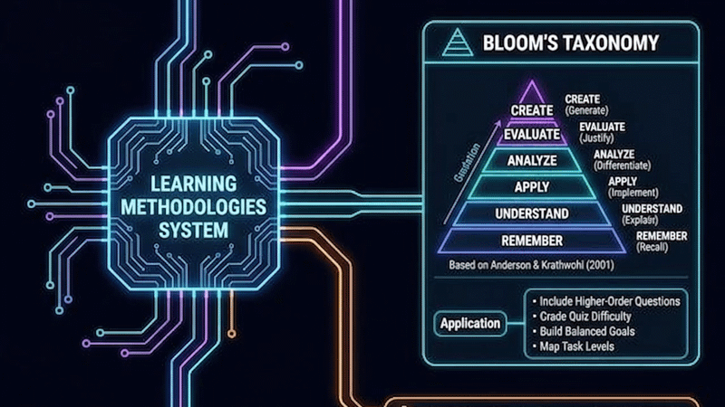

# learning-methodologies

> 📖 **Článek a kontext na Vibemaker:** [Ať vaše výuková aplikace opravdu učí](https://vibemaker.cz/clanek/vzdelavaci-metodiky-pro-vibekoding/)

[](https://vibemaker.cz/clanek/vzdelavaci-metodiky-pro-vibekoding/)

A portable AI skill for designing and reviewing educational applications. It connects learning goals, learner activity, feedback and evidence, then helps turn those decisions into application behavior.

## Author

**Luděk Sušický** — biologist, secondary-school and university teacher of computing subjects

- E-mail: [ludek.susicky@gmail.com](mailto:ludek.susicky@gmail.com)
- X: [@ludeksusicky](https://x.com/ludeksusicky)
- LinkedIn: [Luděk Sušický](https://www.linkedin.com/in/ludek-susicky/)
- GitHub: [@siberius](https://github.com/siberius) — more educational projects and open-source applications

MIT licensed. The English edition is independent of any national curriculum and does not require runtime AI, accounts or a particular model.

Current version: **1.3.0**. All language editions include a short working route, decision examples, tutor modes and resumable learning, concept maps, and explicit rules for model choice and escalation. Named model configurations are starting recommendations, not cross-provider test results.

## Why these methods guide development with AI

The skill contains didactic methods suitable for designing educational applications with AI assistance. They shape what a learner does and how the application responds: retrieval governs when to reveal an answer, scaffolding governs help, assessment governs what can be inferred from a result, and learner self-regulation frameworks (e.g. FALR) govern active interaction with AI to prevent cognitive offloading. These choices give generated code reviewable learning requirements. Using AI at authoring time does not require an AI service in the finished application. See the [didactic rationale](references/didactic-rationale.md) for method-to-behavior examples and limits.

## What it helps you do

- Choose methods from a concrete learning need and classroom context.
- Support learner self-regulation in a shared cognitive space with AI (FALR framework: choice, cognitive pause, evaluation and self-direction) to prevent cognitive offloading.
- Design useful help, error feedback and independent practice.
- Separate goals, task difficulty, prerequisites and evidence of achievement.
- Build trustworthy simulations and bounded AI tutoring when appropriate.
- Consider accessibility, teacher control, learner data and operating constraints.
- Distinguish a working app, a defensible teaching design and observed learning outcomes.
- Choose a task-appropriate model, effort and serving speed using dated OpenAI, Claude and Gemini guidance, with verification status kept explicit.

Methods include Socratic learning, the Feynman technique, the Zone of Proximal Development and scaffolding, worked examples, retrieval and spaced practice, metacognition, inquiry, role-play, peer and cooperative learning, projects and flipped teaching. They are options selected for the task; installing the skill does not make them mandatory features.

## Installation and Quick Start

Install the skill into your coding agent (Claude Code, Cursor, Codex, Antigravity, OpenCode and others) using the `skills` CLI from [skills.sh](https://skills.sh):

```bash
# Install the international English edition
npx skills add siberius/learning-methodologies

# Or install globally across all your projects
npx skills add siberius/learning-methodologies -g

# Install the Czech edition (includes Czech RVP/ŠVP curriculum guidance)
npx skills add siberius/learning-methodologies --skill vzdelavaci-metodiky --full-depth
```

You can also test the skill on-the-fly without permanently installing it:

```bash
npx skills use siberius/learning-methodologies
```

## Choose an edition

- [SKILL.md](SKILL.md) and `references/`: native bundle with conditional detail. Keep the files together.
- [learning-methodologies.md](learning-methodologies.md): generated standalone file for agents accepting Markdown instructions directly. It contains the core and all references.

The native and standalone formats come from the same maintained sources. Edit `SKILL.md` and the relevant reference, then regenerate the standalone edition. Do not edit the generated copy separately.

## Example request

> Use learning-methodologies to build an offline circuit activity for 16-year-olds. Learners should predict how resistance changes current and explain their reasoning. It will support a teacher-led discussion and must work by keyboard. Use no accounts or external AI calls.

The agent should reuse this context, choose proportionate support and identify how the activity can reveal understanding. It should ask only about missing information that changes the design.

## Documentation

- [Usage and installation](docs/USAGE.md)
- [Teacher guide and example briefs](docs/TEACHERS.md)
- [Version history](CHANGELOG.md)

## Language editions

| Language | Native package and documentation | Standalone file |
|---|---|---|
| English | [English](README.md) | [learning-methodologies.md](learning-methodologies.md) |
| Czech | [Čeština](cs/README.md) | [vzdelavaci-metodiky.md](cs/vzdelavaci-metodiky.md) |
| Russian | [Русский](ru/README.md) | [metodiki-obucheniya.md](ru/metodiki-obucheniya.md) |
| Spanish | [Español](es/README.md) | [metodologias-de-aprendizaje.md](es/metodologias-de-aprendizaje.md) |

Russian and Spanish translate the international English foundation without assuming a particular country's curriculum. Czech adds conditional RVP/ŠVP guidance. Use one edition appropriate to the task. These are localized instructions, not a claim of live testing in all languages or model providers.

## Czech edition

[Vzdělávací metodiky](cs/README.md) adapts the same methodological foundation for Czech-language work and, where relevant, Czech schools, RVP/ŠVP, classroom conditions and answer formats. It has its own native [SKILL.md](cs/SKILL.md) and generated [standalone Markdown](cs/vzdelavaci-metodiky.md). Use one suitable language edition; loading both is not normally necessary. Shared principles are maintained together, while Czech curriculum guidance stays conditional.

The workflow is a design aid. It does not certify accessibility, subject accuracy or educational effectiveness. Use checks appropriate to the subject, learners and consequences.

## License

MIT, copyright 2026 Luděk Sušický. See [LICENSE](LICENSE). Preserve the copyright and license notice when redistributing any edition. Linked publications retain their own rights.

## Model evaluation

Use the [eight-task evaluation protocol](docs/MODEL-EVALUATION.md) to compare configurations. The protocol is prepared, not an executed benchmark.
