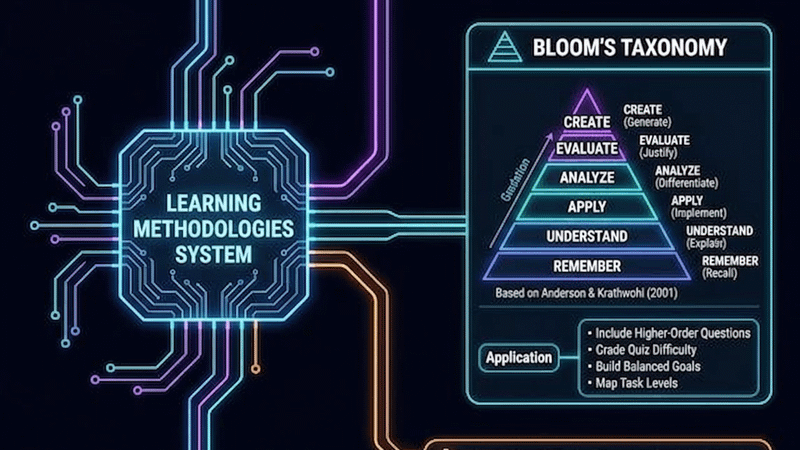

# Vzdělávací metodiky

> 📖 **Článek a metodika na Vibemaker:** [Ať vaše výuková aplikace opravdu učí](https://vibemaker.cz/clanek/vzdelavaci-metodiky-pro-vibekoding/)

[](https://vibemaker.cz/clanek/vzdelavaci-metodiky-pro-vibekoding/)

Česká varianta skillu learning-methodologies pro návrh, tvorbu a posuzování vzdělávacích aplikací. Propojuje cíl, činnost žáka, podporu, hodnocení a doklady učení. Vychází z anglické verze 1.3.0 a doplňuje české školní prostředí.

## Autor

**Luděk Sušický** — biolog, středoškolský a vysokoškolský učitel informatických předmětů

- E-mail: [ludek.susicky@gmail.com](mailto:ludek.susicky@gmail.com)
- X: [@ludeksusicky](https://x.com/ludeksusicky)
- LinkedIn: [Luděk Sušický](https://www.linkedin.com/in/ludek-susicky/)
- GitHub: [@siberius](https://github.com/siberius) — další vzdělávací projekty a otevřené aplikace

Verze **1.3.0** zahrnuje stručný pracovní postup, příklady rozhodování, režimy tutora a návaznost učení, pojmové mapy a pravidla volby modelu i zvýšení uvažování. Konkrétní konfigurace jsou výchozí doporučení, nikoli výsledky srovnávacího testu.

## Instalace a rychlé spuštění

Nainstaluj skill do svého AI asistenta (Claude Code, Cursor, Codex, Antigravity, OpenCode a dalších) přes CLI standard [skills.sh](https://skills.sh):

```bash
# Instalace české varianty s podporou RVP/ŠVP
npx skills add siberius/learning-methodologies --skill vzdelavaci-metodiky --full-depth

# Nebo instalace globálně pro všechny své projekty
npx skills add siberius/learning-methodologies --skill vzdelavaci-metodiky --full-depth -g

# Instalace mezinárodní anglické verze
npx skills add siberius/learning-methodologies
```

Vyzkoušet skill bez trvalé instalace lze jednorázovým příkazem:

```bash
npx skills use siberius/learning-methodologies@vzdelavaci-metodiky
```

## Zvol podobu

- [SKILL.md](SKILL.md) a složka `references/`: nativní balíček s podrobnostmi načítanými podle úkolu.
- [vzdelavaci-metodiky.md](vzdelavaci-metodiky.md): generovaný samostatný Markdown obsahující jádro i reference.

Obě podoby vznikají ze stejných zdrojů. Upravuj jádro a příslušnou referenci; samostatnou podobu generuj. Neudržuj dvě ručně upravované kopie.

## Proč metody patří do vývoje pomocí AI

Skill obsahuje didaktické metody vhodné pro návrh a tvorbu vzdělávacích aplikací s pomocí AI. Určují činnost žáka a reakci aplikace: vybavování mění okamžik odhalení, scaffolding nabídku pomoci, hodnocení meze závěrů o výkonu a rámce sebeřízení žáka (např. FALR) aktivní interakci s AI k zamezení kognitivního offloadingu. Generovaný kód tak dostává ověřitelné vzdělávací požadavky. AI při tvorbě neznamená povinnou AI službu v hotové aplikaci. Podrobnosti a hranice vysvětluje [didaktické zdůvodnění](references/didakticke-zduvodneni.md).

## Metodický základ

Skill výslovně zahrnuje sokratické učení, Feynmanovu techniku, zónu nejbližšího vývoje a scaffolding, řešené příklady, vybavování a opakování s odstupem, metakognici a sebeřízení žáka ve sdíleném kognitivním prostoru s AI (rámec FALR), práci s chybou, badatelskou výuku, hraní rolí, vrstevnické a kooperativní učení, projektovou výuku, převrácenou třídu a volitelnou gamifikaci.

Bloomova taxonomie pomáhá vymezit cíle. Hodnocení řeší kritéria, rubriky, podmínky pomoci a meze závěrů o učení. Metody jsou nabídka; jejich výběr vychází z cíle a situace.

## Česká doplnění

- Postup pro ověřování návaznosti na konkrétní RVP a ŠVP, jejich verze a obory; bez dodaných podkladů zůstává návaznost návrhem.
- Výuka se sdílenými zařízeními, společnou projekcí a různými předpoklady žáků.
- Čeština jako druhý jazyk a oddělení jazykové a oborové náročnosti.
- České číselné zápisy, jednotky, diakritika a přijímání alternativních odpovědí podle cíle.
- Odborný výcvik, laboratorní příprava a hranice simulovaného výkonu.
- Rozlišení metodického návrhu, pravidel školy a ověřených zkušebních požadavků.
- Podmíněný průvodce modely OpenAI, Claude a Gemini, jejich nastavením a načítáním skillu. Doporučení vycházejí z datované dokumentace, nikoli z předstíraných srovnávacích testů.

Český jazyk neznamená povinné RVP u každého projektu. Aplikace může být offline, bez účtů a bez živé AI.

## Použití

> Použij vzdělávací metodiky. Navrhni patnáctiminutovou offline aktivitu pro dvojice v 8. ročníku. Žáci mají předpovědět, jak změna odporu ovlivní proud při stejném napětí, ověřit předpověď a vysvětlit výsledek. Máme sdílená zařízení. ŠVP zatím nedodávám; návaznost nevydávej za ověřenou.

Další postupy najdeš v [použití a instalaci](docs/POUZITI.md) a v [průvodci pro učitele](docs/PRO-UCITELE.md).

## Další jazykové verze

[English](../README.md) · [Русский](../ru/README.md) · [Español](../es/README.md). Ruština a španělština překládají mezinárodní základ; neprohlašují soulad s kurikulem konkrétní země. Podle úkolu načti jednu verzi.

## Licence a meze

MIT, copyright 2026 Luděk Sušický. Zachovej [úplné licenční oznámení](LICENSE). Odkazované publikace mají vlastní práva. Skill poskytuje metodický postup, nezaručuje vzdělávací účinek, kurikulární soulad ani certifikovanou přístupnost konkrétní aplikace.

## Ověření modelů

Pro porovnání konfigurací použij [protokol osmi úloh](docs/OVERENI-MODELU.md). Jde o připravený postup, nikoli provedený benchmark.
